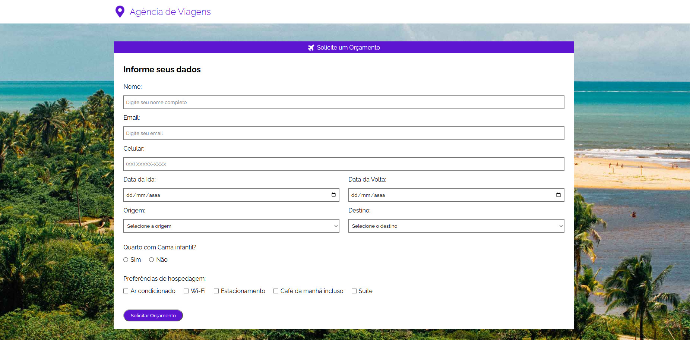

# ✈️ Agência de Viagens

Projeto desenvolvido durante meus estudos de **Desenvolvimento Web**, com o objetivo de praticar a criação de uma página para uma agência de viagens, aplicando conceitos de **HTML5 e CSS3**.

O projeto simula o site de uma agência de viagens, apresentando destinos turísticos, opções de viagens e ofertas, com uma interface organizada e agradável.

---

## 📌 Sobre o projeto

A **Agência de Viagens** foi desenvolvida como um projeto de aprendizado para colocar em prática os conhecimentos adquiridos durante meus estudos de desenvolvimento web.

A proposta foi criar uma página visualmente agradável para uma agência de viagens, trabalhando principalmente a estruturação do conteúdo, a organização dos elementos e a estilização da interface.

---

## 🚀 Tecnologias utilizadas

- HTML5
- CSS3

---

## 💻 Funcionalidades

- Página inicial com apresentação da agência
- Seção de destinos turísticos
- Apresentação de ofertas de viagens
- Cards com informações sobre os destinos
- Utilização de imagens para destacar os destinos e as ofertas
- Navegação entre as seções da página

---

## 📚 O que aprendi

Durante o desenvolvimento deste projeto, pude praticar:

- Estruturação de páginas utilizando **HTML semântico**
- Organização de conteúdo utilizando diferentes elementos HTML
- Estilização de páginas utilizando **CSS**
- Utilização de **Flexbox**
- Criação e estilização de cards
- Organização de imagens e elementos visuais
- Utilização de variáveis CSS com `:root`
- Organização de arquivos e pastas de um projeto web

---

## 🌐 Acesse o projeto

<a href="https://projeto-ag-de-viagem.vercel.app" target="_blank">Acesse o site!</a>

---

## 📷 Preview

---

## 👨‍💻 Desenvolvido por

**Bruno Barros**.

Desenvolvido como parte dos meus estudos em **Desenvolvimento Web**.
